# CampusConnect

[](https://github.com/praveen-here50/Campus-Connect/actions/workflows/ci.yml)
[](LICENSE)

> Find the people to build it with: teammates by skill, team workspaces and a campus knowledge hub.

**Live demo: [campusconnect-tn.vercel.app](https://campusconnect-tn.vercel.app)**. Click **Try the demo** on the sign-in
page, or sign in with `demo@demo.campus.edu` and password `campus-demo-1`. The server sleeps when nobody has visited for a
while, so the first page can take up to a minute.

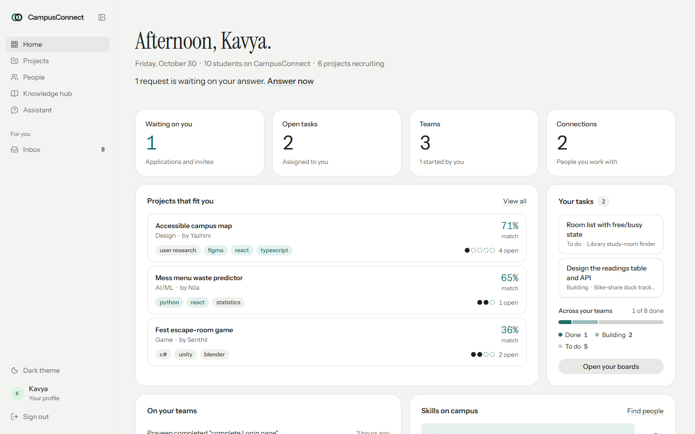

CampusConnect helps students turn an idea into a team. **Students** list their skills and find projects with a free
seat that fits them. **Project owners** post what they are building and the skills they need, then invite or accept
the right people. **Teams** work in a shared workspace with a task board, live chat and an activity feed. What the
campus learns along the way goes into a **knowledge hub** that anyone can search, by words or by meaning, and an AI
assistant answers from it with sources.

---

## Features

| | |
|---|---|
| **Matching by skill and meaning** | Projects ranked for each student, and students for each project, from skill overlap plus pgvector embeddings of profiles and listings. |
| **Projects and requests** | Listings with the skills and seats they need; apply, invite, accept, decline, leave and remove members. The seat strip shows a team as its seats, open ones dashed. |
| **Team workspace** | Task board (to do, building, done), real-time chat over WebSocket, an activity feed and pushes and pull requests from GitHub. |
| **Knowledge hub** | Questions and write-ups in Markdown, answers, upvotes and tags, searched by keyword or by meaning. |
| **Campus assistant (AI)** | Answers from hub posts and open projects with the sources it used, knows the student's skills and best matches; also drafts project listings, suggests next tasks and reads résumés (Gemini, free tier). |
| **Profiles and people** | Skills with levels, availability, a profile photo, GitHub, LinkedIn and portfolio links, résumé import, people search and connection requests. |
| **Inbox and email** | Live notifications and a requests inbox; welcome, application, invitation, weekly digest and reminder emails through n8n. |
| **Works on phones** | Responsive layouts with a slide-in menu, and light and dark themes that follow the system. |

<table>
<tr>
<td>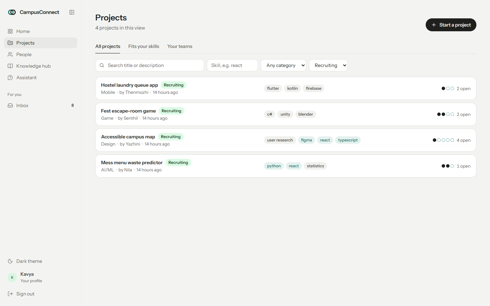</td>
<td>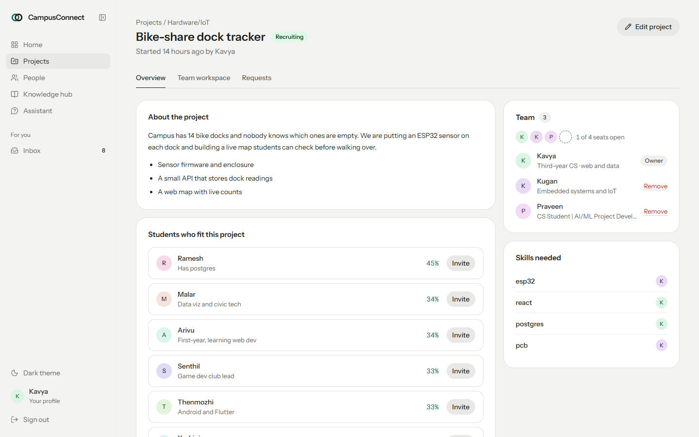</td>
</tr>
<tr>
<td>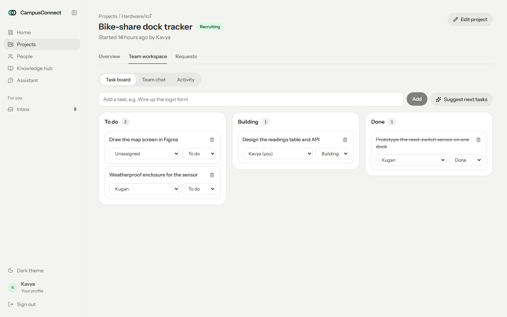</td>
<td>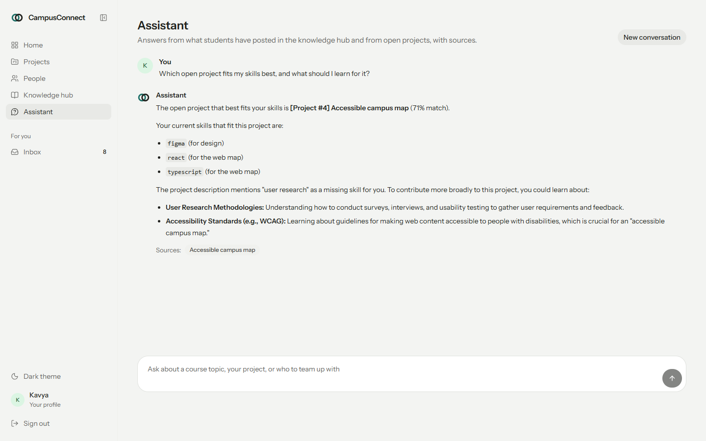</td>
</tr>
<tr>
<td>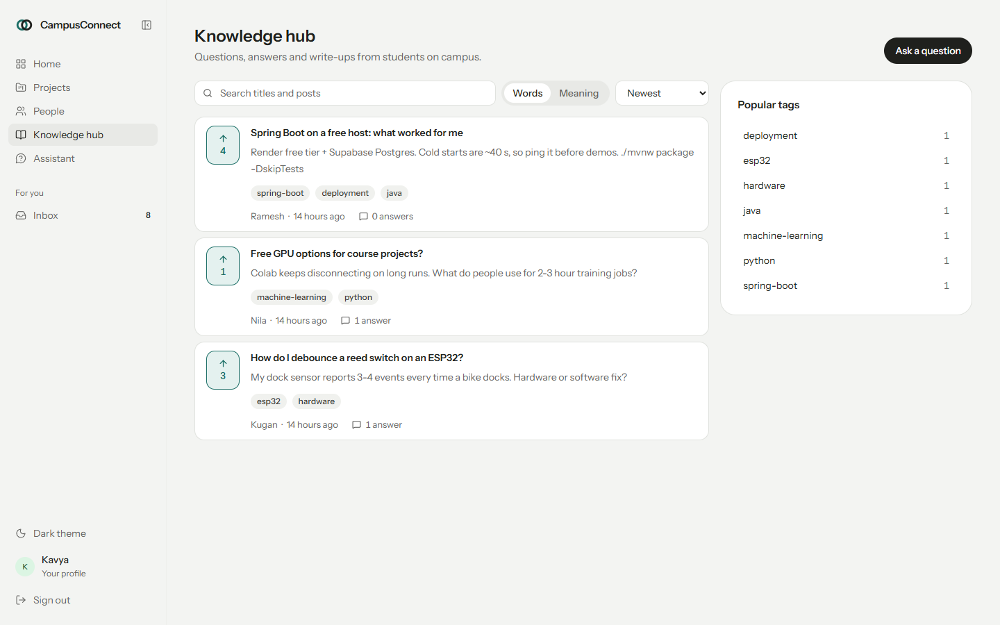</td>
<td>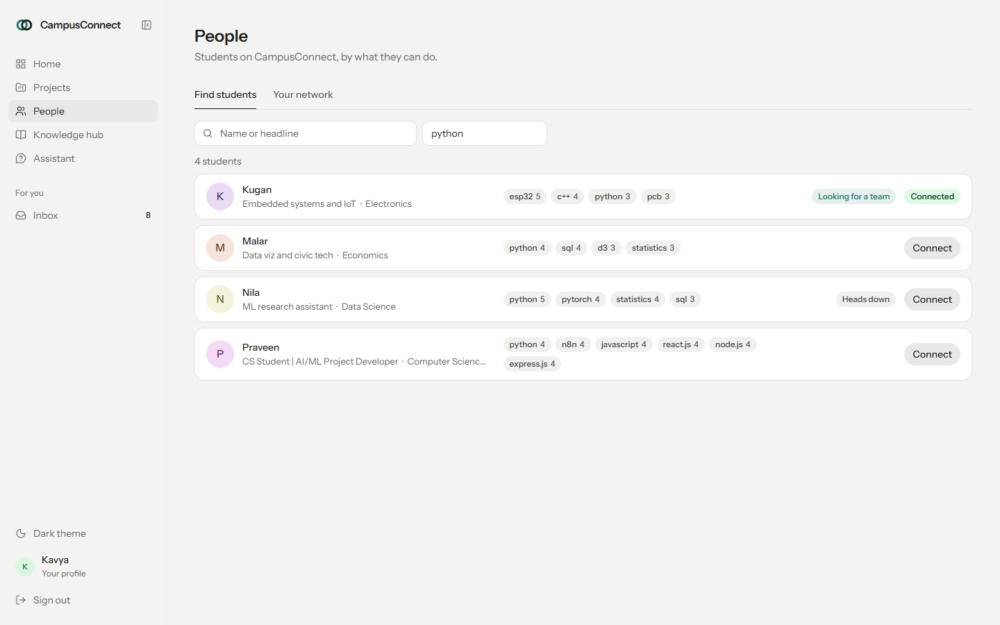</td>
</tr>
<tr>
<td>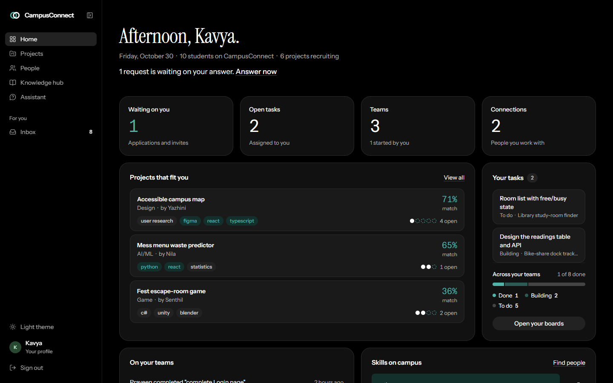</td>
<td>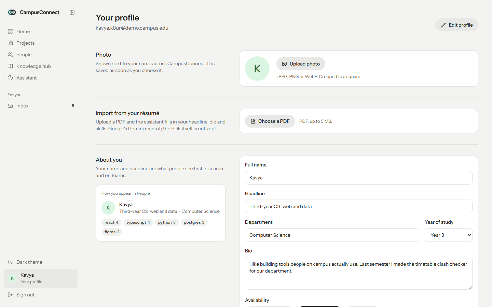</td>
</tr>
</table>

<p align="center">
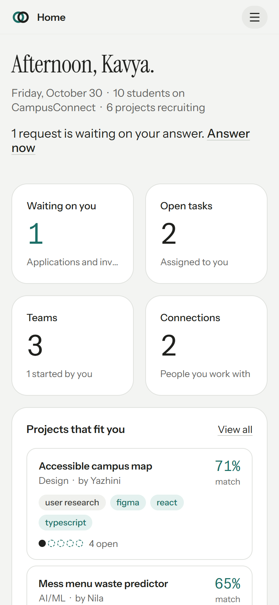
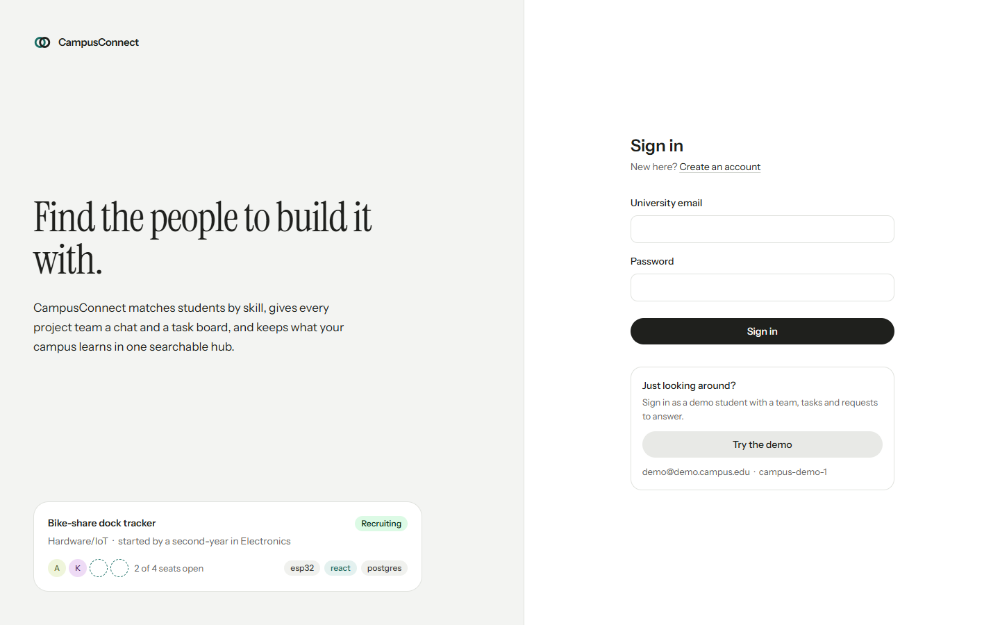
</p>

---

## Architecture

```
┌──────────────┐   REST /api, JWT    ┌──────────────┐  JPA, Flyway  ┌──────────────────┐
│   Frontend   │────────────────────▶│   Backend    │──────────────▶│   PostgreSQL     │
│ React 19,    │◀── chat, activity ──│ Spring Boot 4│               │   + pgvector     │
│ Vite         │   (STOMP over /ws)  └──┬────────┬──┘               └──────────────────┘
└──────────────┘                        │        │
                    ┌───────────────────┘        └───────────────────┐
                    ▼                                                ▼
           ┌─────────────────┐                              ┌─────────────────┐
           │   Gemini API    │                              │       n8n       │
           │ chat, embeddings│                              │ emails, digest, │
           │  (free tier)    │                              │   reminders     │
           └─────────────────┘                              └─────────────────┘
```

| Part | Stack | Details |
|---|---|---|
| `frontend/` | React 19, TypeScript, Vite 8, Tailwind CSS 4, TanStack Query, React Router 7, STOMP.js | Every screen, light and dark themes |
| `backend/` | Java 25 (builds on 21), Spring Boot 4, Spring Security (JWT), JPA, Flyway, WebSocket/STOMP, Spring AI 2, PDFBox | REST API, access rules, matching, assistant, moderation, automation API |
| `automation/n8n/` | n8n workflows | Event emails, weekly digest, reminder for unanswered applications |
| Database | PostgreSQL 17 with pgvector | `pgvector/pgvector` locally, Neon when deployed |

Backend packages: `auth`, `user` (profiles, photos, connections), `project` (projects, members, applications, tasks),
`team` (chat, activity, GitHub), `knowledge` (posts, comments, votes), `notification`, `dashboard`, `ai` (embeddings,
matching, assistant, moderation, usage limit), `automation`, `common`, `config`.

---

## Run it

You need **Docker** and **Node.js 20.19+**.

```bash
# 1. Settings: copy the example and add a free Google AI Studio key (aistudio.google.com/apikey) for the AI features
cp backend/.env.example backend/.env

# 2. Database and API on http://localhost:8080
docker compose up -d --build

# 3. The site on http://localhost:5173
cd frontend
npm install
npm run dev

# 4. Demo students, projects, chats and posts (prints the main student's sign-in)
node scripts/seed-demo.mjs
```

Without an AI key everything works except the AI features, and matching uses skills only. The dev server proxies
`/api` and `/ws` to port 8080 and must run on 5173, the address the API allows; if the port is taken it stops instead
of moving to another one. To run the frontend in Docker instead: `docker compose --profile web up`.

### Demo accounts

Password for all: `campus-demo-1`. The main student is the demo account, `demo@demo.campus.edu`; the others have a
short code from the seed run in their address, `<name>.<code>@demo.campus.edu`, and the script prints it. (Running the
script again makes a second set, with the main student at `kavya.<code>@demo.campus.edu`.)

| Student | Who | Good for trying |
|---|---|---|
| `demo@demo.campus.edu` | Kavya, third-year CS, web and data | Owner of Bike-share dock tracker with a request waiting; Home, inbox, workspace |
| `kugan.<code>@demo.campus.edu` | Kugan, embedded systems and IoT | Member of the Bike-share team, hub author |
| `ramesh.<code>@demo.campus.edu` | Ramesh, backend in Java and Go | Owner of Library study-room finder |

Also Nila, Yazhini, Thenmozhi, Senthil, Malar and Arivu, each with their own skills and projects.

### On a phone

1. Connect the phone to the same Wi-Fi as the computer.
2. Start the site with `npm run dev -- --host` (in `frontend/`).
3. Find the computer's address (`ipconfig` on Windows, "IPv4 Address" under Wi-Fi) and open `http://<that address>:5173`.
4. To sign in from the phone, allow your network: copy `.env.example` to `.env` at the root and set
   `FRONTEND_URLS=http://localhost:5173,http://192.168.*:5173` (or `http://10.*:5173`; `*` matches any part, so a new
   Wi-Fi address still works), then `docker compose up -d backend`.

### Tests

```bash
cd backend && ./mvnw test            # unit tests: AI usage limit, photo type checks (the full-app test runs when DB_URL is set)
cd frontend && npx tsc -b && npx oxlint && npm run build
```

GitHub Actions runs both on every push and pull request ([`.github/workflows/ci.yml`](.github/workflows/ci.yml)).

> **Windows with Smart App Control on:** Windows may block the unsigned native binaries Vite, Tailwind and oxlint
> use ("An Application Control policy has blocked this file"). Run those commands in Docker
> (`docker compose --profile web up`) or WSL instead.

---

## Deploy

A free public deployment: frontend on **Vercel**, API on **Render** (Docker), database on **Neon**.

1. **Neon:** create a project (region: Singapore). From its connection details (direct connection, not pooled), note
   the host, database, user and password. pgvector is available; the first start of the API enables it and creates
   the tables.
2. **Render:** New → Blueprint → this repository. It reads [`render.yaml`](render.yaml), makes the JWT secret itself
   and asks for:
   - `DB_URL`: `jdbc:postgresql://<host>/<database>?sslmode=require`, and `DB_USERNAME`, `DB_PASSWORD` from Neon
   - `AI_API_KEY`: from aistudio.google.com/apikey
   - `FRONTEND_URLS`: the Vercel address (step 3), e.g. `https://campus-connect.vercel.app,https://campus-connect-*.vercel.app`

   If you don't know the Vercel address yet, put a placeholder and change it on Render's Environment page after step 3.
3. **Vercel:** Add New → Project → this repository, Root Directory `frontend` (it reads
   [`frontend/vercel.json`](frontend/vercel.json)), with the environment variable
   `VITE_API_URL=https://<render-service>.onrender.com`. For a public demo, also set `VITE_DEMO_EMAIL=demo@demo.campus.edu`
   and `VITE_DEMO_PASSWORD=campus-demo-1`: the sign-in page then offers **Try the demo**.
4. **Demo data (optional):** `node scripts/seed-demo.mjs https://<render-service>.onrender.com`.
5. **Emails (optional):** host n8n (n8n Cloud or a small Docker host), import the workflows as in
   [Automation](#automation-n8n), change `http://backend:8080` in their three HTTP Request nodes to the Render address,
   and set `N8N_WEBHOOK_URL` and the same `AUTOMATION_API_KEY` on Render.

**Changes after deploying:** push to `main`. Vercel rebuilds the frontend, and Render rebuilds the backend when
`backend/` changed, within a few minutes. Settings are changed on each dashboard's Environment page. Database changes go
in a new migration (`backend/src/main/resources/db/migration/V3__....sql`); never edit one that has already run.

**Free-plan behaviour:** Render puts the API to sleep after 15 minutes without visitors, and the first visit after that
takes up to a minute (the site says so if it cannot connect). A free uptime monitor (e.g. UptimeRobot) opening
`https://<render-service>.onrender.com/actuator/health` every 10 minutes keeps it awake.

---

## Configuration

Locally in `backend/.env` (see [`backend/.env.example`](backend/.env.example)); on Render, its Environment page.

| Variable | Needed for | Notes |
| --- | --- | --- |
| `DB_URL`, `DB_USERNAME`, `DB_PASSWORD` | always | Set by docker compose locally; from Neon when deployed |
| `JWT_SECRET` | always | 32+ random characters; Render generates it |
| `FRONTEND_URLS` | always | Allowed origins for sign-in and live chat, comma-separated; `*` matches any part |
| `AI_API_KEY` | AI features | Google AI Studio key. Blank turns the AI features off |
| `AI_REQUESTS_PER_MINUTE` | optional | Language-model calls per minute for everyone together (default 10, the Gemini free tier) |
| `ASSISTANT_QUESTIONS_PER_HOUR` | optional | AI requests one student may make per hour (default 10, 0 for no limit) |
| `AI_BASE_URL`, `AI_CHAT_MODEL`, `AI_EMBEDDING_MODEL` | optional | Any OpenAI-compatible provider; embeddings must be 768-dimensional |
| `N8N_WEBHOOK_URL`, `AUTOMATION_API_KEY` | emails | Where the backend sends events, and the key n8n uses for `/api/automation/**` |
| `GITHUB_WEBHOOK_SECRET` | GitHub feed | The secret entered in the repository's webhook settings |

Frontend: `VITE_API_URL` (production builds only) is the backend's public address; in development Vite proxies `/api`
and `/ws`. `VITE_DEMO_EMAIL` and `VITE_DEMO_PASSWORD` show a demo account on the sign-in page (unset hides it).

## Automation (n8n)

The workflows live in `automation/n8n/`. With the `automation` profile they are mounted at `/workflows` in the n8n
container:

```bash
docker compose --profile automation up -d
docker compose exec n8n n8n import:workflow --separate --input=/workflows
```

Then in n8n (http://localhost:5678):

1. Create a **Header Auth** credential named `CampusConnect API key`: header `X-Api-Key`, value = your
   `AUTOMATION_API_KEY`.
2. Create an **SMTP** credential named `CampusConnect SMTP` (e.g. a Gmail app password: smtp.gmail.com, port 465, SSL).
3. Open each workflow, pick the two credentials in every node that uses one (a credential shown by name only is not
   linked yet), **save it (Ctrl+S)**, then activate it. Imported workflows have no saved version until their first save
   in the editor, and n8n refuses to activate them before that. Import each file once: importing again makes copies.
4. Set `N8N_WEBHOOK_URL=http://n8n:5678/webhook/campusconnect` in the root `.env` and the same `AUTOMATION_API_KEY` in
   `backend/.env`, then `docker compose up -d backend`.

| Workflow | Trigger | Does |
| --- | --- | --- |
| Event emails | `POST /webhook/campusconnect` from the backend | Welcome email on sign-up, email the owner on a new application, email a student on an invitation |
| Weekly digest | Mondays 09:00 | `GET /api/automation/weekly-digest`, email each student their invites, tasks and new matching projects, then leave an in-app note |
| Unanswered applications | Daily 18:00 | `GET /api/automation/stale-applications?days=3`, nudge the owner by email |

## GitHub activity feed

Owners add the repository (`owner/repo`) to the project. In the GitHub repository: Settings → Webhooks → Add webhook,
payload URL `https://<backend>/api/integrations/github`, content type `application/json`, secret =
`GITHUB_WEBHOOK_SECRET`, events "Pushes" and "Pull requests". Every member then sees pushes and pull requests in the
workspace's Activity tab and gets a notification.

## API overview

All endpoints except `/api/auth/**`, `GET /api/users/{id}/avatar`, `/api/integrations/github` and `/api/automation/**`
need `Authorization: Bearer <jwt>`. Errors are RFC 9457 problem details with a readable `detail`.

| | |
| --- | --- |
| Auth | `POST /api/auth/register`, `POST /api/auth/login` |
| Users | `GET/PUT /api/users/me`, `POST/DELETE /api/users/me/avatar`, `GET /api/users?q=&skill=`, `GET /api/users/{id}`, `GET /api/users/avatars`, `GET /api/users/{id}/avatar` |
| Connections | `GET/POST /api/connections`, `POST /api/connections/{id}/accept`, `DELETE /api/connections/{id}` |
| Projects | `GET/POST /api/projects`, `GET /api/projects/mine`, `GET /api/projects/by-user/{id}`, `GET/PUT/DELETE /api/projects/{id}`, `DELETE /api/projects/{id}/members/{userId}` |
| Requests | `POST /api/projects/{id}/applications`, `POST /api/projects/{id}/invites`, `GET /api/projects/{id}/applications`, `GET /api/applications/mine`, `GET /api/applications/incoming`, `POST /api/applications/{id}/accept\|reject`, `DELETE /api/applications/{id}` |
| Tasks | `GET/POST /api/projects/{id}/tasks`, `PUT/DELETE /api/tasks/{id}` |
| Team | `GET/POST /api/projects/{id}/messages`, `GET /api/projects/{id}/activity`; STOMP: send `/app/projects/{id}/chat`, subscribe `/topic/projects/{id}/chat`, `/topic/projects/{id}/activity`, `/user/queue/notifications` |
| Knowledge | `GET/POST /api/posts`, `GET /api/posts/semantic?q=`, `GET /api/posts/tags`, `GET/DELETE /api/posts/{id}`, `POST /api/posts/{id}/vote`, `POST /api/posts/{id}/comments`, `DELETE /api/comments/{id}` |
| Notifications | `GET /api/notifications`, `GET /api/notifications/unread-count`, `POST /api/notifications/{id}/read`, `POST /api/notifications/read-all` |
| AI | `GET /api/ai/status`, `GET /api/ai/recommendations/projects`, `GET /api/ai/recommendations/projects/{id}/teammates`, `POST /api/ai/assistant`, `POST /api/ai/resume` (multipart `file`), `POST /api/ai/project-draft`, `POST /api/ai/projects/{id}/task-suggestions` |
| Dashboard | `GET /api/dashboard` |
| Automation | `GET /api/automation/weekly-digest`, `GET /api/automation/stale-applications?days=`, `POST /api/automation/notifications` (header `X-Api-Key`) |

## Design

An "editorial greeting" app style: Instrument Sans with an Instrument Serif greeting, white panels with a 1px edge on an
off-white ground, no shadows, near-black pill buttons, and one teal accent kept for data (match scores, open seats,
progress, your own skills). The product's own element is the **seat strip**: a team drawn as its seats, filled by
members and dashed where a seat is still open. Light and dark themes follow the system, with a toggle in the sidebar.

---

## Status and limits

Working prototype with demo data. Before real students rely on it:

- **Accounts:** anyone can sign up; there is no email verification, password change or reset, and no limit on wrong
  password attempts yet. The sign-in token is kept in the browser's local storage.
- **Data sent to the AI:** assistant questions, project ideas and résumé text go to Google's Gemini API, and profiles,
  projects and posts are embedded there for matching. Use a paid key or your own OpenAI-compatible model
  (`AI_BASE_URL`) for data that must stay private.
- **Gemini's free tier** allows only a few requests a minute in total (`AI_REQUESTS_PER_MINUTE`), and each student may
  make 10 AI requests an hour (`ASSISTANT_QUESTIONS_PER_HOUR`).
- **Profile photos** are served at a public address (an image tag cannot send the sign-in token), so anyone with the
  link can see one. Only JPEG, PNG and WebP are accepted, checked by content.
- **Demo data is not reset automatically:** students sign up for real, so a nightly reset would delete their accounts.
  Seed a fresh set with `scripts/seed-demo.mjs` when needed.
- **Emails** need n8n hosted somewhere and an SMTP account; without them the app works and only the emails are missing.
- Student and project names in the demo data are made up.

---

## License

[MIT](LICENSE)
